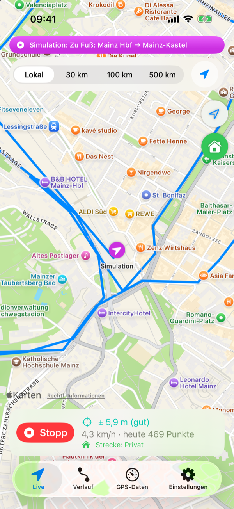
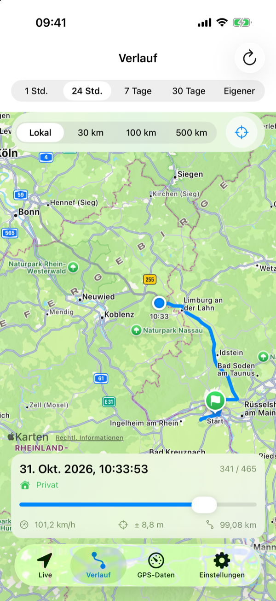
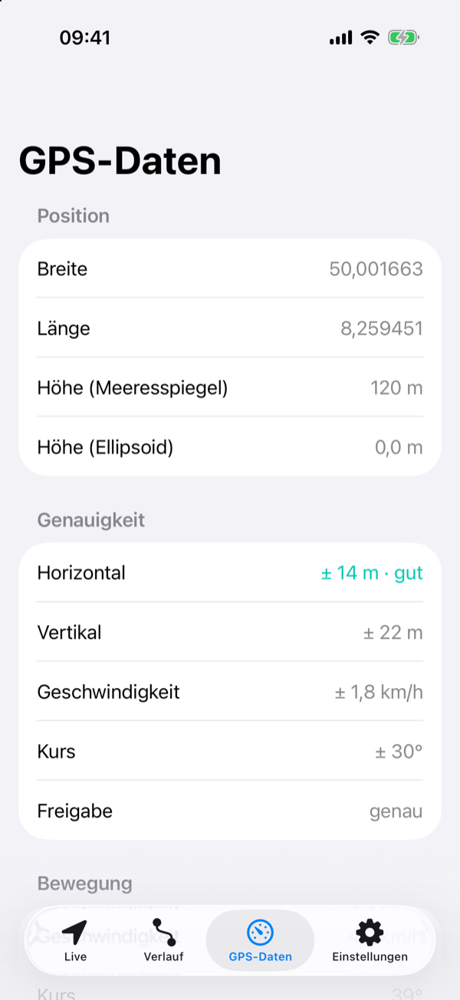
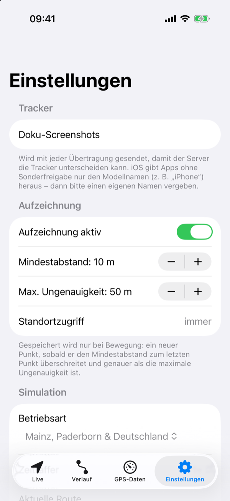
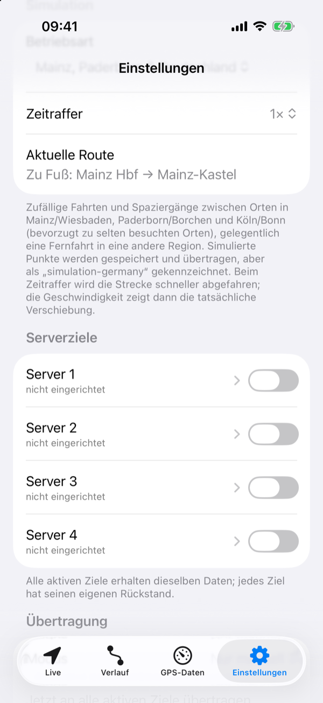
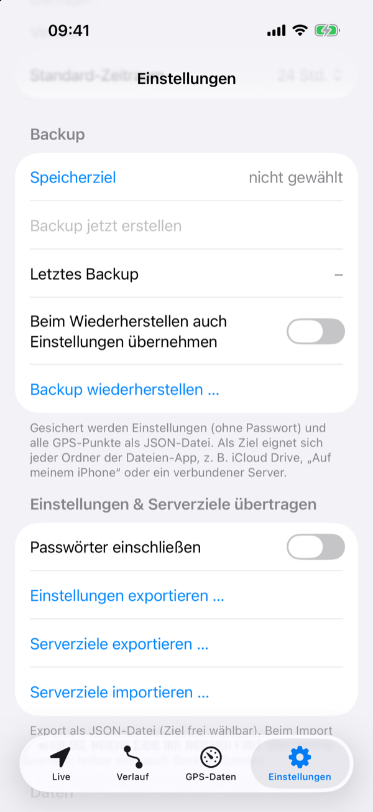

# Funktionen

Stand: v0.11.2 (31.10.2026)

Die Bilder zeigen den Release-Build im Simulator mit Daten aus der Simulation (Betriebsart „Mainz, Paderborn &
Deutschland“), also keine echten Fahrten und keine eingerichteten Server.

## Tab „Live“

- Karte folgt der aktuellen Position (Benutzerstandort-Button, Kompass, Maßstab).
- **Genauigkeitskreis** um die Position, Farbe nach Qualität (grün ≤ 5 m, mint ≤ 15 m, orange ≤ 50 m, rot darüber).
- Heutiger Weg (ab 0:00 Uhr) als blaue Linie.
- Statusleiste: **Start/Stopp** der Aufzeichnung, Genauigkeit, Geschwindigkeit, Anzahl Punkte heute,
  Hinweis bei Stillstand oder fehlender Berechtigung.

- **Kartenausschnitt** (Leiste oben): *Lokal* = automatisch auf die Umgebung des Trackers;
  *30 km / 100 km / 500 km* = feste Breite, zentriert auf den Tracker. Auswahl wird gespeichert.
- **Folgen** (Knopf rechts in der Leiste): Karte führt der Position nach bzw. bleibt stehen. Bei festen
  Ausschnitten wird erst nachgeführt, wenn der Tracker > 10 % der Breite aus der Mitte gewandert ist.
- **Privat/geschäftlich** (runder Button unter dem Positionsbutton): Haus = privat (grün), Koffer = geschäftlich
  (orange). Ein Tipp wechselt, die Wahl bleibt gespeichert und gilt für alle Punkte ab jetzt; die Statusleiste zeigt
  sie an. Im Verlauf steht die Art des Punkts am Slider.
- Bei Simulation: lila Marker mit Fahrtrichtung und Banner „Simulation: <Route>“.

## Tab „Verlauf“

- Zeitraum: 1 Std., 24 Std., 7 Tage, 30 Tage oder eigener Zeitraum (Von/Bis); Vorauswahl aus den Einstellungen.
- Gesamter Weg grau, der Teil bis zur Slider-Zeit blau, Startpunkt als Flagge.
- Pausen über 5 Minuten trennen die Linie (getrennte Fahrten werden nicht verbunden).
- **Zeit-Slider**: verschiebt einen Marker entlang der Zeitachse; angezeigt werden Datum/Uhrzeit,
  Punkt x von n, Geschwindigkeit, Genauigkeit und zurückgelegte Strecke bis dahin.
- **Kartenausschnitt** (Leiste über der Karte): *Lokal* passt die ganze Spur ein; *30 / 100 / 500 km*
  zeigen eine feste Breite um den Slider-Punkt und folgen ihm beim Abspielen. Knopf ⌖ zentriert neu.
- Bei sehr vielen Punkten wird die Linie zur Darstellung ausgedünnt (max. ~4000 Stützpunkte).
- „Aktualisieren“ setzt das Ende des Zeitraums auf jetzt.

## Tab „GPS-Daten“

- Position: Breite, Länge (6 Nachkommastellen ≈ 0,1 m), Höhe über Meeresspiegel und Ellipsoid, ggf. Stockwerk.
- Genauigkeit: horizontal (mit Bewertung), vertikal, Geschwindigkeit, Kurs, Freigabe genau/ungefähr.
- Bewegung: Geschwindigkeit (km/h), Kurs (°), Stillstand/in Bewegung.
- Zeit: Messzeit, Alter der Messung (sekündlich aktualisiert), Quelle (Gerät/simuliert).
- Quelle: Gerät / simuliert bzw. „Simulation – <Betriebsart>“ mit aktueller Route.
- Status: Aufzeichnung, Tracker-Name, Software-Version, Standortberechtigung, Diagnosehinweise.
- Speicher: Punkte gesamt.
- Übertragung: je aktivem Serverziel offene Punkte (rot bei Fehler) und letzte Übertragung.
- Hinweis: Satellitenanzahl/Rohdaten stellt Apple nicht bereit.

## Tab „Einstellungen“

  

- **Tracker**: Name des Trackers (Vorschlag Gerätename, Button „Gerätenamen übernehmen“).
- **Simulation**: Betriebsart (Aus / Mainz, Paderborn & Deutschland / Flughafen Köln/Bonn),
  Zeitraffer 1×/5×/20×/60×, aktuelle Route. Am Flughafen zufällige Abschnitte über das ganze Gelände
  plus gelegentliche Ausflüge nach Köln/Bonn (Auto oder Bahn).
- **Aufzeichnung**: an/aus, Mindestabstand (1–500 m), max. Ungenauigkeit (5–500 m), Berechtigungsstatus,
  „Immer“ anfragen, Absprung in iOS-Einstellungen.
- **Serverziele** (4 Stück): Zeile mit Name, Host, offenen Punkten bzw. „Fehler“ und Schalter **Aktiv**.
  Tippen öffnet die Details: Name, Aktiv, URL (Prüfung auf http/https), Benutzer, Passwort,
  Status (offen, letzte Übertragung, Fehler), „Jetzt an dieses Ziel übertragen“,
  „Rückstand verwerfen …“, „Alle Punkte erneut senden …“.
- Im Release-Build sind alle Ziele leer. Nur Debug-Builds mit eigener `PrivateDefaults.json` belegen Ziel 4 vor; dort
  gibt es auch den Knopf „Viewer-Adresse eintragen“. Bei Tailscale-IPs erscheint eine Warnung.
- **Übertragung**: Modus Live (Sammelintervall) / Zeitgesteuert (Uhrzeit, nächster Lauf) / Nur manuell –
  gilt für alle aktiven Ziele; „Jetzt an alle aktiven Ziele übertragen“, Summe offener Punkte.
- **Verlauf**: Standard-Zeitraum.
- **Backup**: Speicherziel wählen, Backup erstellen, letztes Backup, Wiederherstellen (optional mit Einstellungen).
- **Einstellungen & Serverziele übertragen**: Schalter „Passwörter einschließen“, „Einstellungen exportieren …“
  (alle Einstellungen inkl. Ziele), „Serverziele exportieren …“ (nur Ziele) als JSON über den Dateien-Dialog;
  „Serverziele importieren …“ mit Auswahl je Ziel (übernehmen ja/nein, Platz 1–4, Hinweis auf das ersetzte Ziel,
  Sperre bei doppelter Platzbelegung). Lesbar: Einstellungs-/Ziele-Exporte, Backups, `.gpsziel`.
- **Details eines Ziels → Weitergeben**: „Passwort mitsenden“, „Per E-Mail senden …“ (E-Mail mit `.gpsziel`-Anhang,
  Empfänger trägt man selbst ein; nur mit eingerichtetem Mail-Konto), „Teilen …“ (Teilen-Menü).
- **Öffnen von `.gpsziel`-Dateien** aus Mail/Dateien mit „GPS Tracker“ → Import-Auswahl erscheint direkt.
- **Daten**: alle GPS-Daten löschen (mit Bestätigung).
- **Info**: Software-Version „0.3.0 (3)“, Geräte-ID (wird an den Server mitgesendet), OSM-Hinweis.

## Hintergrundverhalten
- Aufzeichnung läuft weiter, wenn die App im Hintergrund ist (blaue Standortanzeige in der Statusleiste).
- Wird die App von iOS beendet und neu gestartet, setzt sie die Aufzeichnung automatisch fort.
- Zeitgesteuerte Übertragung nutzt zusätzlich iOS-Hintergrundaktualisierung.
